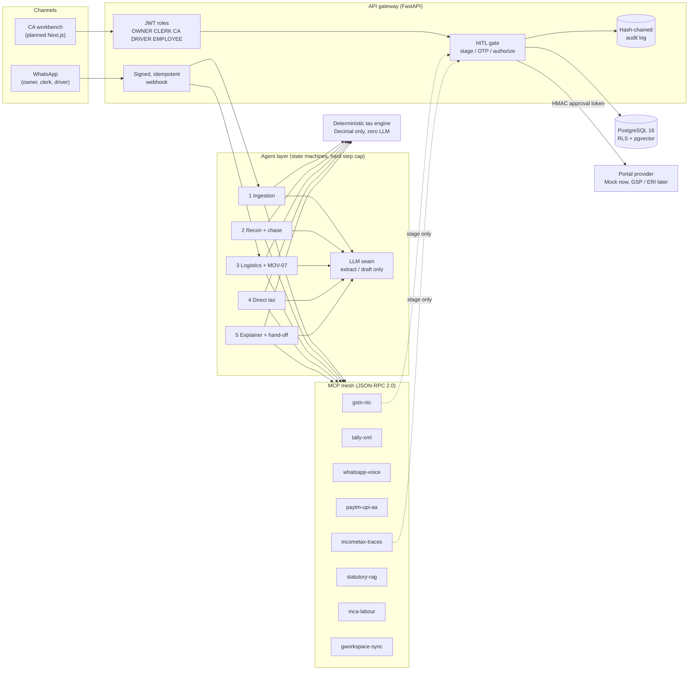
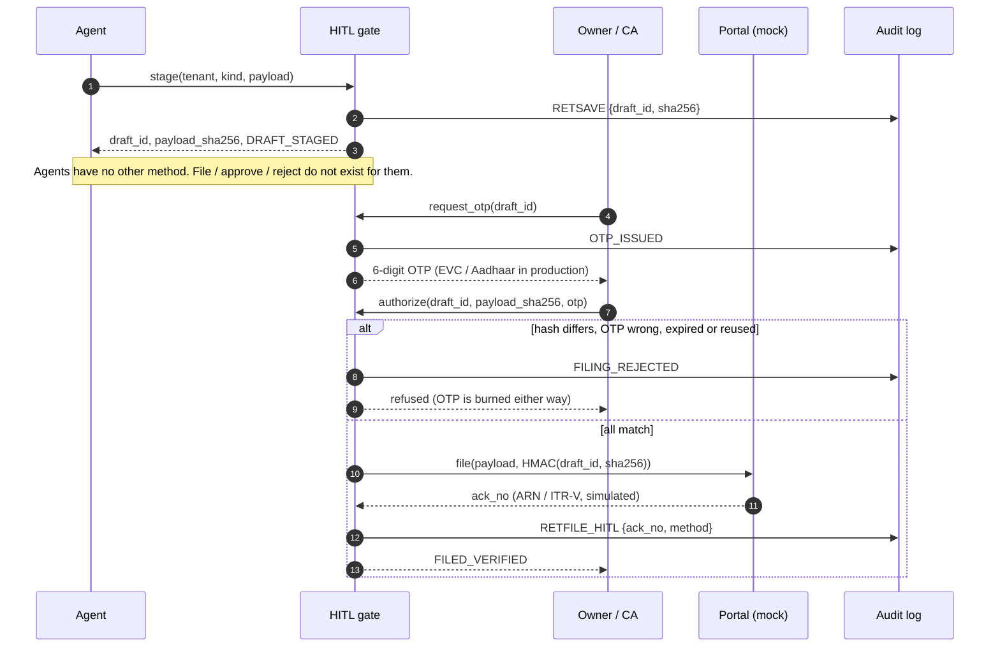
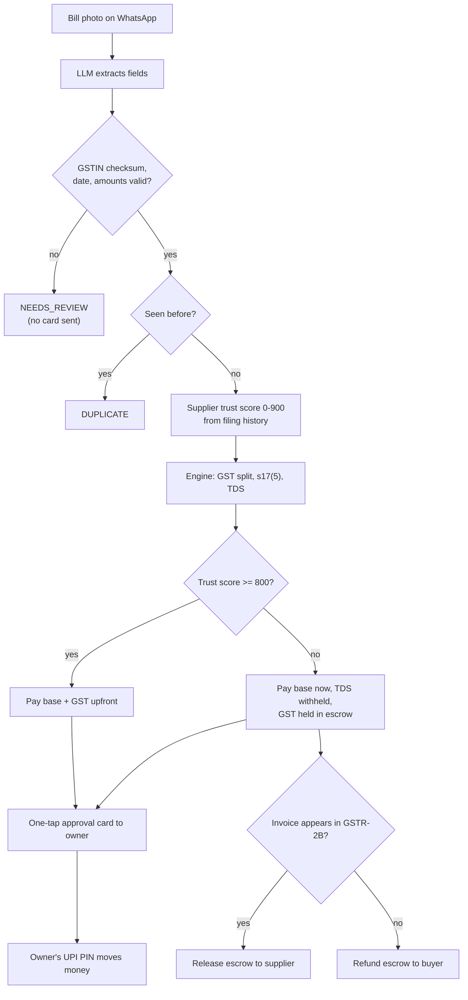
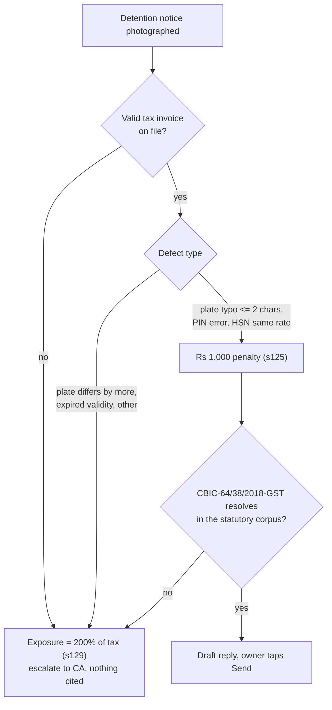

<div align="center">

# TaxSetu AI

**An agentic compliance co-pilot for Indian micro-enterprises.**
WhatsApp-first for the owner · multi-client workbench for the CA · a human OTP is the only thing that can file.

[](https://github.com/loktrishal-05/taxsetu-ai/actions/workflows/test.yml)


</div>

> **Problem statement 3.1.** A shop owner with a phone and a shoebox of bills should not need to understand GSTR-2B, Rule 37,
> Section 194C or Circular 64/38 to stay compliant. TaxSetu AI reads the bills, does the arithmetic, chases the suppliers, drafts the
> replies, and then **stops** — filing stays with the owner or a professional.


---

## Contents

1. [Design principles](#design-principles)
2. [Architecture](#architecture)
3. [The five agents](#the-five-agents)
4. [Workflows](#workflows)
5. [MCP server mesh](#mcp-server-mesh)
6. [Data model and tenant isolation](#data-model-and-tenant-isolation)
7. [What the deterministic engine covers](#what-the-deterministic-engine-covers)
8. [Security model](#security-model)
9. [Screenshots](#screenshots)
10. [API reference](#api-reference)
11. [Repository layout](#repository-layout)
12. [Quickstart](#quickstart)
13. [Testing](#testing)
14. [Deployment](#deployment)
15. [Status, limits and roadmap](#status-limits-and-roadmap)

---

## Design principles

| # | Principle | How it is enforced in code |
|---|-----------|----------------------------|
| 1 | **Neuro-symbolic split.** LLMs only *extract, classify and draft*. They never compute tax, interest, TDS or ITR. | All arithmetic lives in `packages/deterministic-tax-engine`, which has no LLM import. Agents call it; LLM output is validated before use. |
| 2 | **Agents prepare, humans file (FR-025).** | Agents receive an `AgentTools` object with only `stage` and `get`. The MCP mesh refuses to register any tool named like `retfile`, `file_*`, `ims_reject`, `authorize`, `otp`. |
| 3 | **Non-repudiation.** A filing is bound to the exact bytes the owner saw. | Single-use OTP bound to `SHA-256(payload)`; any edit invalidates it; the portal re-verifies an HMAC approval token; audit events are hash-chained. |
| 4 | **Exact money.** | `Decimal` end-to-end, HALF_UP rounding, and the API serialises money as strings (never floats). |
| 5 | **No hallucinated law.** | A citation is usable only if it resolves in the effective-dated statutory corpus; Circular 64/38 relief is unlocked by a deterministic gate first. |
| 6 | **Tenant isolation in the database, not the app.** | PostgreSQL `FORCE ROW LEVEL SECURITY` keyed on `app.tenant_id`, with a non-bypass application role. |
| 7 | **Bounded autonomy.** | Every agent graph has a hard step cap; supplier nudges are capped at 3 per invoice with a 48 h cooldown, enforced in the tool *and* the engine. |

---

## Architecture



**Reading the diagram.** Agents sit in the middle and can reach exactly two things: the deterministic engine (pure functions) and the
MCP mesh (a fixed list of tools). There is no arrow from the agent layer to the portal. The only path to the portal runs through the
gate, and the gate only moves when a human supplies a valid OTP.

### Layers at a glance

| Layer | Package | Responsibility |
|-------|---------|----------------|
| Engine | `packages/deterministic-tax-engine` | GST, TDS, ITR routing, presumptive tax, refunds, 2B reconciliation, e-Way Bill, MOV-07 gate, split-pay, Tally XML |
| MCP mesh | `packages/mcp-servers` | Eight tool/resource servers with a JSON-RPC 2.0 core and an air-gap name guard |
| Agents | `packages/agents` | Five graph-shaped agents, an `Llm` protocol with a deterministic stub, a loop-capped graph runner |
| Gateway | `apps/api-gateway` | FastAPI edge, JWT roles, WhatsApp webhook, HITL gate, mock portal, audit chain, sandbox storyline |
| Infra | `infra/` | Postgres schema with row-level security, docker-compose (Postgres, Redis, MinIO) |

---

## The five agents

| Agent | Trigger | What it does | What it *cannot* do |
|-------|---------|--------------|---------------------|
| **1 Ingestion** | Bill photo / PDF on WhatsApp | Extract → validate GSTIN checksum → de-duplicate (`SHA-256(gstin + normalised inv no + FY)`) → supplier trust score from GSTN history → GST split, §17(5) blocked-credit check, TDS → send a one-tap approval card | Guess on a bad extraction (returns `NEEDS_REVIEW`); move money |
| **2 Recon + chase** | 14th of the month (GSTR-2B ready) | 4-way match (exact / fuzzy ≤2 edits / mismatch / missing), Rule 37 180-day clock, one nudge attempt per invoice per run | Send a 4th nudge, or nudge inside 48 h — it escalates to the CA queue |
| **3 Logistics** | Plate + invoice photo, or a detention notice | Validate OCR'd plate, block duplicate EWBs, stage an EWB with a 4-hour pre-expiry alert, draft the MOV-07 reply | Cite Circular 64/38 without a valid invoice + clerical defect + a citation that resolves in the corpus |
| **4 Direct tax** | Month-end / year-end | Presumptive income from GST sales vs bank credits, 5 % cash-ceiling guardrail, ITR form routing, stage the ITR, diagnose unclaimed refunds and draft §119(2)(b) petitions | Stage a presumptive ITR once the cash ceiling is breached (escalates to CA); use ITR-U for a refund |
| **5 Explainer + hand-off** | Before each deadline | Build Tally XML packets for the CA, stage the return, produce a vernacular voice summary | Say a number the engine did not produce — ungrounded prose is replaced by a fixed template |

---

## Workflows

### 1. Human-in-the-loop filing (the non-repudiation gate)



Edit a draft after the OTP is issued and its hash changes, so the OTP no longer matches. Missing and foreign drafts return the same
`draft not found`, so a tenant cannot probe for other tenants' draft ids.

### 2. Supplier bill to split payment



Worked example from the report: an invoice of ₹1,00,000 + 18 % GST, supplier below the trust threshold, 194C at 2 % →
**₹98,000 pay now · ₹2,000 TDS · ₹18,000 GST escrow** (conserved: the split asserts `base + TDS + escrow = total`).

### 3. Checkpoint defence (MOV-07)



In the sandbox this is the headline number: **₹72,000 exposure drops to ₹1,000** for a one-character plate typo, and stays at
₹72,000 with *no* citation when the invoice is missing.

### 4. Monthly compliance rhythm

| Day | Who | What happens |
|----:|-----|--------------|
| daily | Owner / clerk / driver | Bills, plates and notices go to WhatsApp; Agents 1 and 3 respond within seconds |
| 9-10 | Agent 5 | Tally packets and the vernacular summary are prepared for the CA and the owner |
| 11 | Deadline | GSTR-1 |
| 14 | Agent 2 | GSTR-2B is ready: reconcile, then nudge 1 to each defaulting supplier |
| 16, 18 | Agent 2 | Nudges 2 and 3, never closer than 48 h; the fourth attempt escalates to the CA exception queue |
| 18-19 | Owner / CA | Review staged drafts; owner approves with the OTP |
| 20 | Deadline | GSTR-3B |
| 31 Jul | Deadline | ITR (presumptive filers) |

---

## MCP mesh

Eight isolated servers speak MCP's JSON-RPC 2.0 (`initialize`, `tools/list`, `tools/call`, `resources/templates/list`,
`resources/read`) over stdio: `python -m taxsetu_mcp <server>`. Agents use the in-process `Client` with the same call surface.

| Server | Tools (hitl-annotated in *italics*) | Resources | State |
|--------|-------------------------------------|-----------|-------|
| `gstn-nic` | `stage_gstr1_or_3b_retsave`, *`generate_eway_bill_v103`*, *`extend_or_update_ewb_part_b`*, *`draft_mov07_circular_64_38_reply`* | `gst://taxpayer/{gstin}/public-profile`, `gst://returns/{gstin}/{period}/gstr2b` | Mock sandbox |
| `tally-xml` | *`post_tally_voucher`*, *`create_party_ledger`* | `tally://company/active/masters`, `…/daybook/{date}` | Dry-run transport; XML validated and balance-checked |
| `whatsapp-voice` | `send_interactive_approval_card`, `dispatch_supplier_2b_nudge`, `push_vernacular_voice_summary` | `whatsapp://thread/{phone}/history` | Mock outbox; nudge cap enforced here |
| `paytm-upi-aa` | *`execute_split_vendor_payout`* (creates an *intent* only), `release_or_refund_gst_escrow`, `generate_smart_compliance_receipt` | `bank://aa/{pan}/statements/{month}`, `escrow://gst-holds/active` | Mock; partial receipt |
| `incometax-traces` | `evaluate_itr_eligibility_1_to_7`, `compute_presumptive_44ad_44ada_44ae`, *`validate_and_stage_itr_json`*, *`generate_sec_119_2b_condonation_petition`* | `itd://pan/{pan}/ais-tis/{ay}`, `…/form26as/{ay}`, `…/5yr-unclaimed-refunds` | Mock sandbox |
| `statutory-rag` | `search_effective_dated_statute`, `verify_citation`, `verify_hsn_sac_tax_rate` | `law://cgst/section/{n}`, `law://incometax/section/{n}`, `law://cbic/circulars/{no}` | Keyword ranking over a small corpus |
| `mca-labour` | *e-MOA / e-AOA / Labour Form A+B generators* | — | Registered; **refuses** until Phase 5 |
| `gworkspace-sync` | `sync_compliance_schedule_to_calendar`, `archive_signed_returns_to_drive` | `gdrive://audit-vault/{fy}/{month}` | In-memory; archives only filed (acknowledged) documents |

---

## Data model and tenant isolation


* Seven tables, every one with `ENABLE` **and** `FORCE ROW LEVEL SECURITY`, policy `tenant_id = current_setting('app.tenant_id', true)`.
* The application connects as `taxsetu_app` (`NOSUPERUSER NOBYPASSRLS`); with no tenant set, queries return zero rows.
* The audit table is granted `SELECT, INSERT` only — it is append-only by privilege as well as by policy.
* Static checks run on every CI build; a live cross-tenant test runs when Postgres is available (see [Testing](#testing)).

---

## What the deterministic engine covers

| Area | Coverage |
|------|----------|
| **GST** | GSTIN Mod-36 checksum, PAN format; CGST/SGST/IGST split (SGST absorbs the rounding paisa); §17(5) blocked credit (prefix/keyword heuristic); GTA 5 % RCM; Rule 37 180-day clock; §47 late fee; §50 interest |
| **TDS** | 194C (single/aggregate threshold catch-up, 1 %/2 %), 194J (10 %/2 % technical), 194H, 194Q; GST excluded from the base; no PAN → 20 % |
| **Income tax** | New/old slabs AY 2026-27, 87A rebate + marginal relief, 4 % cess, regime comparison; 44AD / 44ADA / 44AE; 5 % cash-ceiling guardrail (WARN ≥ 3.8 %, BREACH > 5 %); ITR-1…7 router |
| **Refunds** | Six pathways (139(1), 139(4), 139(5), §119(2)(b) condonation to 31 Mar of AY+6, Form 30, §154) plus reissue; ITR-U is never offered for a refund |
| **Reconciliation** | 4-way GSTR-2B match with Levenshtein ≤ 2; nudge governor (max 3, 48 h cooldown) |
| **e-Way Bill** | Validity (1 day / 200 km, expiry at midnight), ±8 h extension window, 4 h pre-expiry alert, MOV-07 / Circular 64-38 eligibility |
| **Payments** | Supplier GST trust score 0–900, three-way split, balanced multi-ledger postings, MDR/TCS/TDS unbundling, Tally purchase-voucher XML |

> Rates and thresholds are encoded from the source report plus AY 2026-27 slabs and live in single tables so a CA can audit and edit
> them. **Treat every figure as unverified until a practising CA signs it off.**

---

## Security model

| Threat | Mitigation | Test |
|--------|-----------|------|
| Prompt-injected agent tries to file or reject | No such tool exists; names are blocked at registration; gate needs a human OTP | `test_hitl_airgap`, `test_forbidden_tool_names_cannot_even_be_registered` |
| OTP replay / brute force | Single-use (burned on success *and* failure), 300 s TTL, bound to payload hash | adversarial suite |
| Edit-after-approval swap | Edit re-hashes the draft and voids the OTP; portal re-checks HMAC over the hash | adversarial suite |
| Cross-tenant read / write | RLS + same error for missing vs foreign drafts | `test_rls_isolation`, adversarial suite |
| Audit tampering | SHA-256 hash chain, `verify()`; append-only grants | adversarial suite |
| Duplicate bill / duplicate EWB | Composite dedup hash checked before posting or generating | agents tests |
| Supplier-chasing loop | Cap in the WhatsApp tool + engine + graph step cap | `test_recon_agent_loop_is_capped…` |
| Hallucinated statute | Citations must resolve in the effective-dated corpus | MCP + agents tests |
| Hallucinated figures in owner summaries | Every number in LLM prose must equal an engine output, else fixed template | `test_explainer_rejects_llm_prose…` |
| Float drift in money | `Decimal` everywhere; API emits strings | e2e tests |
| WhatsApp webhook forgery / replay | HMAC signature check; idempotent on `wamid` | e2e tests |

---

## Screenshots

These are real captures of the running application (`GET /` → "Run the end-to-end storyline"). One click executes all five agents,
the MCP mesh and the approval gate on fake data and renders the result.

| | |
|---|---|
| **Agent 1–2 · bill to split payment, 2B reconciliation** |  |
| **Agent 3–5 · MOV-07 defence (₹72,000 → ₹1,000), ITR-4, Hindi voice summary** |  |
| **Human gate · wrong OTP refused, correct OTP files, audit chain intact** |  |
| **OpenAPI explorer (`/docs`)** |  |

---

## API reference

Paths below are relative to `/api/v1` unless they start with `/health` or `/`. All routes except `/`, `/health`, `/docs`, the sandbox storyline and the HMAC-signed WhatsApp webhook require a bearer JWT.

| Method | Path | Roles | Purpose |
|--------|------|-------|---------|
| GET | `/` | — | Sandbox landing page |
| GET | `/health` | — | Liveness + audit-chain validity |
| GET | `/api/v1/demo/storyline` | — | Runs the whole flow on fake data, statelessly |
| POST | `/webhooks/whatsapp` | HMAC | Signed, idempotent inbound messages |
| POST | `/gst/{gstin}/reconcile-2b` | OWNER, CA | Deterministic 4-way reconciliation |
| POST | `/ewb/generate-or-defend` | OWNER, CLERK, DRIVER | Stage an EWB or classify a MOV-07 defect |
| POST | `/itr/{pan}/compute-and-stage` | OWNER, CA, EMPLOYEE | Presumptive income, routing, stage ITR |
| GET | `/refund-pathway` | OWNER, CA, EMPLOYEE | Which of the six refund pathways applies |
| POST | `/hitl/request-otp/{draft_id}` | OWNER, EMPLOYEE, CA | Issue the single-use OTP |
| POST | `/hitl/authorize-filing` | OWNER, EMPLOYEE | Verify OTP + hash, file to the mock portal |
| GET | `/audit` | OWNER, CA | Tenant-scoped, hash-chained events |

---

## Repository layout

```text
taxsetu-ai/
├── packages/
│   ├── deterministic-tax-engine/   Decimal-only statutory logic        (no LLM)
│   ├── mcp-servers/                8 MCP servers + JSON-RPC core
│   ├── agents/                     5 agents, graph runner, Llm protocol + stub
│   ├── statutory-rag/              (reserved: pgvector + BM25 corpus)
│   ├── schemas-cbdt-gstn/          (reserved: official JSON-schema validators)
│   └── tally-xml-bridge/           (reserved: TallyPrime bridge)
├── apps/
│   ├── api-gateway/                FastAPI edge, HITL gate, mock portal, audit, sandbox
│   ├── ca-workbench-web/           (planned) Next.js CA console
│   └── mock-gov-portals/           (planned) portal UIs
├── infra/                          Postgres RLS migration, docker-compose
├── tests/                          unit · adversarial · e2e-demo · infra · mcp · agents
├── docs/                           PLAN.md, screenshots
├── index.py                        Vercel entrypoint
├── Dockerfile · render.yaml        Long-running deployment
└── .github/workflows/test.yml      CI
```

---

## Quickstart

```bash
git clone https://github.com/loktrishal-05/taxsetu-ai && cd taxsetu-ai
python -m venv .venv && source .venv/bin/activate        # Windows: .venv\Scripts\activate
pip install pytest httpx uvicorn fastapi "pydantic>=2" \
  -e packages/deterministic-tax-engine -e packages/mcp-servers -e packages/agents -e apps/api-gateway

pytest tests -q                                           # 274 pass, 1 skipped (needs live Postgres)
uvicorn --factory taxsetu_api.main:create_app --port 8000 # then open http://localhost:8000
```

Optional local infrastructure and the live row-level-security test:

```bash
docker compose -f infra/docker-compose.yml up -d          # Postgres 16 + pgvector, Redis, MinIO
pip install "psycopg[binary]" && pytest tests/infra -q
```

Configuration lives in environment variables (see `.env.example`): `DATABASE_URL`, `REDIS_URL`, `PORTAL_MODE=mock`,
`WHATSAPP_APP_SECRET`, `LLM_API_KEY`, and **`HITL_SIGNING_SECRET` — set a long random value in any shared environment**; the built-in
default exists only for local development.

---

## Testing

| Suite | Tests | What it proves |
|-------|------:|----------------|
| `tests/unit` | 200 | Every statutory rule, boundary and rounding case in the engine, plus payments and Tally XML |
| `tests/adversarial` | 13 | Air-gap, OTP replay / expiry / burn, edit-after-OTP, cross-tenant, audit tamper, prompt injection |
| `tests/e2e-demo` | 9 | The report's demo storyline over HTTP, including the sandbox endpoint |
| `tests/mcp` | 25 | JSON-RPC shapes, forbidden tool names, each server's business rules, nudge cap |
| `tests/agents` | 24 | Each agent end to end, loop caps, dedup, grounded-number guard, "only a human can file" |
| `tests/infra` | 4 | RLS on every table, append-only audit, no-bypass role (+1 live cross-tenant test, skipped without Postgres) |
| **Total** | **275** | **274 pass · 1 skipped** |

CI runs the whole suite on every push (Python 3.10).

---

## Deployment

Two shapes, same code:

| Target | Config | Behaviour |
|--------|--------|-----------|
| **Vercel** (serverless) | `index.py`, `requirements.txt` | Stateless: perfect for the sandbox storyline and read-only routes. The in-memory HITL gate does **not** survive across cold instances, so multi-request approval flows need the next option or the Postgres-backed gate. |
| **Render / any Docker host** (long-running) | `Dockerfile`, `render.yaml` | One process keeps the in-memory gate between requests. `HITL_SIGNING_SECRET` is generated by the blueprint. |

```bash
docker build -t taxsetu-api . && docker run -p 8000:8000 -e HITL_SIGNING_SECRET="$(openssl rand -base64 48)" taxsetu-api
```

The deployed build runs the **mock** portal only. Nothing in this repository can file a real return.

---

## Status, limits and roadmap

| Phase | Scope | Status |
|------:|-------|--------|
| 1 | Deterministic tax engine | ✅ done |
| 6a | API gateway, HITL gate, mock portal, audit chain | ✅ done |
| 4 | Payments logic (split, trust score, ledgers, Tally XML) | ✅ core done · UI and UPI rails pending |
| 2 | MCP mesh | ✅ done on mock backends · `mca-labour` generators pending |
| 3 | Five agents | ✅ done offline with a stub LLM · real model adapter and pgvector/BM25 RAG pending |
| 0 | Postgres RLS, compose, CI | 🟡 live RLS test not yet run against a real database |
| 5 | e-MOA / e-AOA, Form 16, Labour Form A/B | ⬜ todo |
| 6b | Next.js CA workbench and mock portal UI | ⬜ todo |
| 7 | Live GSP / ERI integration | ⛔ out of scope (needs licensed credentials) |

**Known limitations — stated plainly**

* The language model is a deterministic **stub**; no vision/LLM provider is wired in yet.
* Draft and audit state are **in memory**; persistence through Postgres is the next backend task.
* The Tally XML shape follows Tally's import format but is **unverified** against a live TallyPrime.
* The HSN rate table is intentionally empty (returns `NOT_FOUND`) rather than guessing rates.
* The report's settlement example is internally inconsistent (₹2,370 of deductions against a quoted ₹97,820 credit); the engine follows the arithmetic (₹97,630).
* The §17(5) blocked-credit check is a heuristic until a CA signs off the full HSN list.

---

<sub>**Not tax or legal advice.** This is a hackathon-grade reference implementation. All rates, thresholds, section references and
templates must be verified by a practising Chartered Accountant before any real-world use. No real filing is ever made by this software.</sub>
