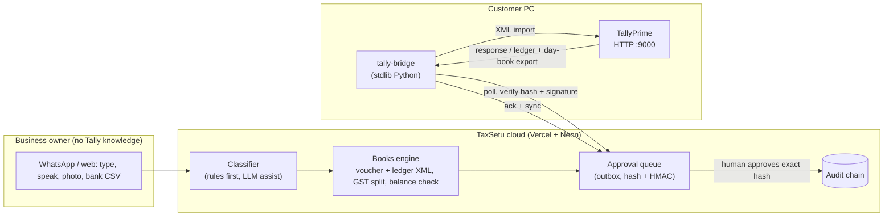

# TaxSetu × Tally: "Tally without knowing Tally"

Goal: a small business owner (or their part-time accountant) who has never learned Tally can keep their books correct by
talking to TaxSetu in plain language, forwarding bills and uploading a bank statement. TaxSetu drafts the Tally entries, a human
approves them, and a small program on the Tally PC posts them. The business pays for far less Tally maintenance work.

## 1. What we learned about Tally (research)

| Fact | Source | Consequence for us |
|------|--------|--------------------|
| TallyPrime runs an HTTP server (default port 9000, enabled in *F1 Help → Settings → Advanced Configuration*). External apps POST an XML `ENVELOPE` with `TALLYREQUEST` = Import / Export / Execute. At least one company must be open. | [Tally XML integration](https://help.tallysolutions.com/xml-integration/) | The XML path works on every TallyPrime and Tally.ERP 9 install. It is our primary integration. |
| Import payload = `IMPORTDATA` → `REQUESTDESC` (`REPORTNAME` Vouchers / All Masters, `STATICVARIABLES/SVCURRENTCOMPANY`) → `REQUESTDATA` → `TALLYMESSAGE` → `VOUCHER` (`VCHTYPE`, `ACTION`) or `LEDGER`. | same | Always pin `SVCURRENTCOMPANY`, otherwise data lands in whatever company is active. |
| Export = `TYPE` Data / Collection / Object with `ID` naming the report; replies carry `STATUS` 1 or 0. | same | We can read ledgers and the Day Book back, to learn the books and to reconcile. |
| Native JSON (`JSONEx`) exists from TallyPrime 7.0. | [Tally JSON integration](https://help.tallysolutions.com/tally-prime-integration-using-json-1/) | Later option. XML stays the baseline because most customers are not on 7.0. |
| TallyPrime can also act as an ODBC server and exposes collections to Excel/VB. | [Tally ODBC](https://help.tallysolutions.com/odbc-integrations/) | Not needed. XML export covers the same reads. |
| GST rates and HSN/SAC can live at company, group, ledger, stock-item or voucher level; the most specific wins. Party masters need GSTIN, registration type, place of supply. | [Setting up GST in TallyPrime](https://help.tallysolutions.com/setting-up-gst-in-tallyprime/) | A wrong or half-done setup is the root of most later pain. Our setup wizard creates a consistent ledger set once. |
| Typical user pain: wrong or blank GSTIN/HSN makes vouchers "uncertain" and drops them from GSTR-1; manual bank reconciliation takes hours; recurring entries are re-keyed monthly. | [Tally data-entry challenges](https://hisabkitab.co/common-challenges-in-tally-data-entry-and-how-automation-solves-them), [GST ledger mistakes](https://suvit.io/post/mistakes-to-avoid-in-tally-gst-ledgers) | These are the first things we automate and check. |
| The Tally port has no password. | third-party guide | Never expose it to the internet. Only a local bridge talks to it. |

**Verified 2026-11-09 on a real TallyPrime Rel 7.2 (Education mode)**, with the HTTP server on (`Client Server=Both` in `tally.ini`):
masters and all five voucher types import and read back correctly; the bridge's selftest passes; the full cloud-to-Tally path passes
(`scripts/tally_e2e.py`, `tests/live`). Real Tally differs from the documentation in ways only a real run reveals:

| Finding | Fix |
|---------|-----|
| A `LEDGER` with only a `NAME` attribute is rejected (`EXCEPTIONS 1`, no message); it needs `NAME.LIST/NAME` | `masters_xml` emits it |
| Replies contain `&#4;`, illegal in XML 1.0, so a strict parser fails the whole document | engine and bridge drop illegal references before parsing |
| Replies contain tags with the word `ENTITY` (`TEMPPARTYENTITY`) | the DOCTYPE/ENTITY guard now matches real declarations only |
| `Day Book` over XML returns an empty body | reads use an inline `Voucher` collection (`TSVouchers`) |
| Import replies are `<RESPONSE>` counters (`CREATED/ALTERED/ERRORS/EXCEPTIONS`); failures carry no text in the reply and `tally.imp` only repeats the summary | parsers handle both shapes; `EXCEPTIONS>0` is failure |
| Education mode only takes vouchers dated the 1st or 2nd of a month (the 15th, 29th and 30th were all rejected) | tests use the 1st/2nd |
| Re-sending a voucher creates a **duplicate**; an explicit `VOUCHERNUMBER` or a `GUID` child does not prevent it, but a `REMOTEID` attribute does (second send: `ALTERED 1`, and a changed amount updates the same voucher) | staged batches write `REMOTEID="ts-<batch id>-<position>"`; position keeps two identical entries apart |
| Non-English names sent as UTF-8 are stored exactly; UTF-16 posts were mis-decoded into `????` ledgers | the bridge stays on UTF-8; do not send UTF-16 |
| A 500-voucher GST batch: 22 s to create, 43 s to re-send, 0.5 MB | the bridge now waits up to 10 minutes for Tally (60 s for the cloud) |

Also confirmed: a three-month, 36-row bank statement imports in 0.9 s and the Bank Account ledger moves by exactly the statement's net;
Tally's Profit & Loss matched independent arithmetic (Sales 7,14,750 = 3 x 30,000 + 6,24,750; Purchases 1,50,000).

Still unverified: other Tally versions, licensed companies, the Edit Log edition.

## 2. Architecture

Design rules (same spirit as the filing gate):

1. **AI drafts, deterministic code decides.** The LLM may extract fields from text; amounts, GST split, balance and ledger
   names are validated by Python. Anything the classifier is unsure about becomes a plain-language *question*, never a guess.
2. **Nothing reaches Tally without human approval of the exact bytes.** The approver confirms the payload SHA-256; the cloud
   signs it with a per-bridge key; the bridge re-verifies before posting.
3. **The bridge can only import vouchers and masters.** It refuses `Delete`, `Cancel`, `Execute` and any other request type.
4. **The cloud never reaches into the PC.** The bridge dials out (poll), so no inbound port is opened and Tally's open port
   stays on localhost.
5. **Learning, not hardcoding.** A per-tenant alias table remembers "Sharma → Rent Paid" after one confirmation.

## 3. Work packages

| # | Package | Where | Status |
|---|---------|-------|--------|
| 1 | Shared models (`VoucherDraft`, `Line`, `LedgerSpec`, `BankTxn`, `BookContext`) | `engine/tally_models.py` | contract |
| 2 | Books engine: voucher/ledger XML, GST-aware drafts, response + export parsers, starter chart of accounts | `engine/tallybooks.py`, `engine/tally_coa.py` | Codex A |
| 3 | Classifier (text → voucher) and bank-statement CSV parser + categoriser | `engine/tally_classify.py`, `engine/tally_bank.py` | Codex B |
| 4 | Bridge agent for the customer PC | `apps/tally-bridge/` | Codex C |
| 5 | Outbox + alias store, migration 0003 (RLS), API routes (sandbox + authenticated + bridge), MCP tools | `apps/api-gateway`, `infra/migrations`, `mcp-servers` | me |
| 6 | "Tally Assistant" UI: setup wizard, type-an-entry, bank-statement review, bridge pairing, plain-language glossary | `apps/ca-workbench-web` | after 5 |
| 7 | Deploy workbench, wire to API, README + screenshots | Vercel | after 6 |

Out of scope for now: Tally JSON (7.0+), TDL customisation, stock/inventory vouchers (accounting vouchers only), multi-company
switching, e-invoice/e-way bill generation from Tally, live GSP filing.
